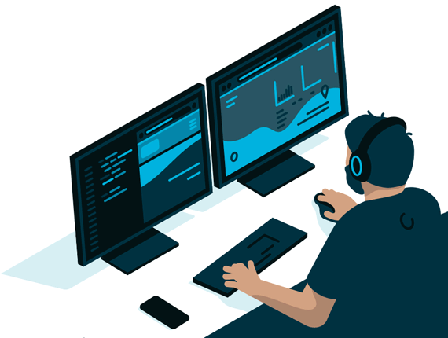

 

## 👨‍💻 About me

I'm a software engineer who loves picking up new technologies and using them to solve real problems. I build web products with **Next.js**, **Node.js** and **Python**, and I maintain and contribute to open-source projects.

If you'd like to collaborate, reach out on [LinkedIn](https://www.linkedin.com/in/seun-sowemimo-8518b7249/) or leave a message on my [portfolio](https://tryraisins.dev).

 

## 🛠️ Languages & tools

  

 

## 🚀 Featured projects

| Project | What it does |
|---|---|
| [**Terror Tracker**](https://terrortracker.tryraisins.dev) | Live incident map for security incidents in Nigeria |
| [**SlopLens**](https://sloplens.tryraisins.dev) | Design audit tool that scores web pages out of 100 |
| [**QuickBillz**](https://quickbillz.tryraisins.dev) | Invoicing without a monthly subscription |
| [**Dyaad**](https://dyaad.tryraisins.dev) | Matches resumes against job briefs |
| [**StreamSlip**](https://streamslip.vercel.app) | Turns your YouTube Music history into a shareable recap |
| **yeknal** | CLI and library of agent skills: `npx yeknal@latest setup` |

 

## 📊 GitHub stats

<table>
<tr>
<td align="center">
  <picture>
    <source media="(prefers-color-scheme: dark)" srcset="https://github-readme-stats.vercel.app/api?username=tryraisins&show_icons=true&hide_border=true&count_private=true&bg_color=00000000&title_color=C77DFF&icon_color=C77DFF&text_color=C9D1D9">
    <source media="(prefers-color-scheme: light)" srcset="https://github-readme-stats.vercel.app/api?username=tryraisins&show_icons=true&hide_border=true&count_private=true&bg_color=00000000&title_color=7B2CBF&icon_color=7B2CBF&text_color=24292F">
    
  </picture>
</td>
<td align="center">
  <picture>
    <source media="(prefers-color-scheme: dark)" srcset="https://github-readme-stats.vercel.app/api/top-langs/?username=tryraisins&exclude_repo=KNN-Image-Classification&hide_border=true&layout=compact&langs_count=8&bg_color=00000000&title_color=C77DFF&text_color=C9D1D9">
    <source media="(prefers-color-scheme: light)" srcset="https://github-readme-stats.vercel.app/api/top-langs/?username=tryraisins&exclude_repo=KNN-Image-Classification&hide_border=true&layout=compact&langs_count=8&bg_color=00000000&title_color=7B2CBF&text_color=24292F">
    
  </picture>
</td>
</tr>
</table>

<picture>
  <source media="(prefers-color-scheme: dark)" srcset="https://streak-stats.demolab.com?user=tryraisins&hide_border=true&background=00000000&ring=C77DFF&fire=FF9F1C&currStreakNum=C9D1D9&sideNums=C9D1D9&currStreakLabel=C77DFF&sideLabels=8B949E&dates=8B949E">
  <source media="(prefers-color-scheme: light)" srcset="https://streak-stats.demolab.com?user=tryraisins&hide_border=true&background=00000000&ring=7B2CBF&fire=FF9F1C&currStreakNum=24292F&sideNums=24292F&currStreakLabel=7B2CBF&sideLabels=57606A&dates=57606A">
  
</picture>

 

  

